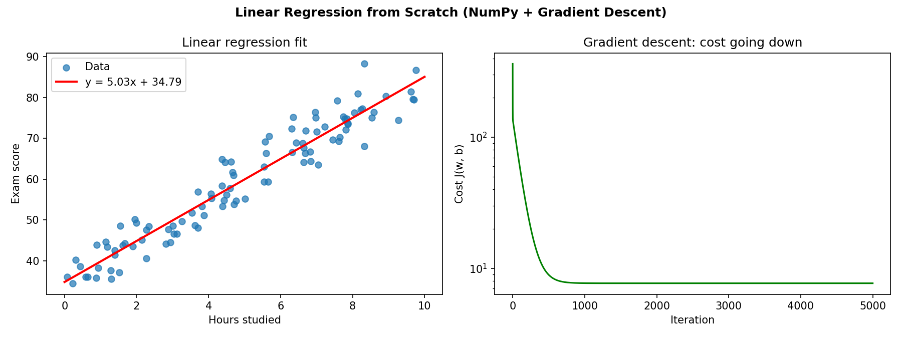

# Linear Regression from Scratch

Predicting exam scores from hours studied, using only NumPy and gradient descent (no scikit-learn).

## What's inside
- Hypothesis function: ŷ = wx + b
- Mean Squared Error cost function
- Gradient descent to learn w and b
- Learning-rate experiment (too small, good, too large)

## Results
- Learned w = 5.03, b = 34.79 (true values: 5 and 35)
- Matches NumPy's polyfit exactly
- R² = 0.92

## How to run
Open `linear_regression_from_scratch.ipynb` in Google Colab or Jupyter and run the cells in order.
Or run the plain script: `python linear_regression_from_scratch.py`

## Requirements
numpy, matplotlib
